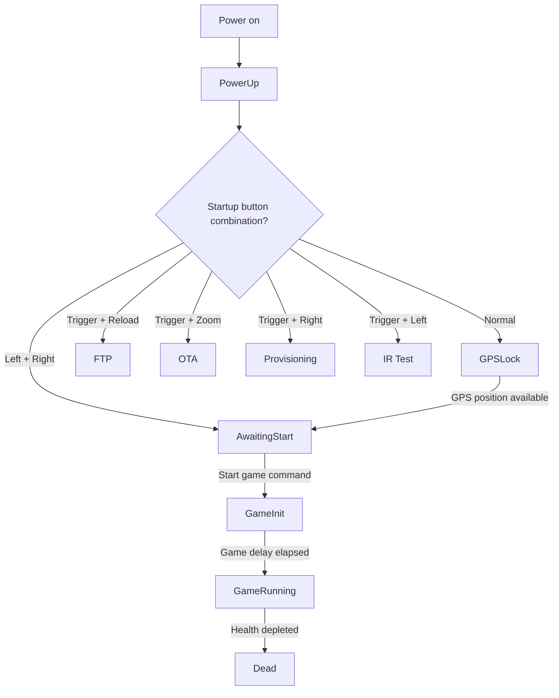

# CombatLR ESP32 Firmware — Software Operation and Architecture

**Document status:** Architecture description based on the repository's `main` branch as inspected on 13 November 2026.  
**Scope:** ESP32 firmware only, with the mobile application and supporting tools described where they interface with firmware.  
**Repository:** [tonygoacher/CombatLR](https://github.com/tonygoacher/CombatLR)  
**Important:** This document is an external working document. No repository files, branches or commits have been changed.

---

## 1. Purpose and system overview

CombatLR is a GPS-based combat royale / laser-tag system. Each player carries an ESP32-S3 N16R8 game unit. The unit manages the player's local game state, infrared weapon operation and hit detection, audio feedback, physical controls, GPS position, map display, zones and pickups.

A companion .NET MAUI application prepares and controls games. It is used to create game plans, configure players and teams, discover game units, transfer game data and start a game. The ESP32 executes the game locally; it does not require the mobile application to remain connected throughout play.

The firmware is best understood as a set of cooperating subsystems:

1. **System state machine** — controls startup, provisioning, waiting, game initialisation, gameplay and maintenance modes.
2. **Weapon subsystem** — manages weapon selection, weapon-specific firing/reload behaviour, ammunition and weapon state transitions.
3. **Game model and zone engine** — interprets the game plan, activates zones, manages transitions and controls pickup availability.
4. **Navigation and time** — parses GPS data, converts geographic coordinates into the local game coordinate system and provides a game clock.
5. **Infrared subsystem** — transmits and receives laser-tag shot packets.
6. **Network subsystem** — provides UDP discovery and TCP commands for the mobile application.
7. **Display subsystem** — renders the map and user interface on the ST7789V display using a separate FreeRTOS task.
8. **Audio and indicators** — plays sound effects and drives the muzzle and hit LEDs.
9. **Persistent storage** — uses LittleFS for configuration, game data and media assets.

The design separates game decisions from presentation and hardware operations. For example, the zone engine decides which zone is active and sends display commands; it does not directly draw pixels.

## 2. Hardware and build platform

The current PlatformIO environment is `esp32s3_n16r8`:

- MCU: ESP32-S3 N16R8 development board (`esp32-s3-devkitc-1`). Due to graphics and sounds, a lot of storage and RAM needed!
- Framework: Arduino.
- Memory configuration: QIO flash / OPI PSRAM.
- Filesystem: LittleFS.
- Display driver: TFT_eSPI configured for ST7789 320x240 display.
- GPS parser: TinyGPSPlus.
- JSON: ArduinoJson 7.
- FTP: SimpleFTPServer.
- Display task: pinned to core 0 by `DisplayManager`.

The display configuration in `Firmware/platformio.ini` specifies a 240 × 320 ST7789 panel, SPI at 40 MHz, and the board's display control pins. The project also uses PSRAM for memory-intensive display and image operations.

Build from the `Firmware` directory:

```sh
pio run -e esp32s3_n16r8
```

Upload over USB using the PlatformIO upload target, or use the OTA mode described later.

### 2.1 Hardware responsibilities

| Hardware | Firmware responsibility |
|---|---|
| GPS module | NMEA input, position, speed, course and UTC time. Baud rate set by "gpsBaudrate" field in system.json |
| ST7789V display | Map, player status, zone geometry, widgets and mode screens |
| IR transmitter | Modulated shot transmission. Uses Milestag format shot protocol modulated at 56kHz. Recommended LED TSAL6100|
| IR receiver | Detect and decode incoming shot packets in Milestag format. Recommended receiver: TSOP4856 |
| Audio amplifier / speaker | Weapon, hit, zone, pickup and status sounds |
| Trigger / reload / left / right / zoom switches | Player input and weapon control |
| Muzzle / hit LEDs | Short visual feedback indications |
| Wi-Fi | Discovery, game commands, FTP and OTA |
| LittleFS | Configuration, map, game plan, weapon data, images and sounds |

Pin assignments are centralised in the firmware's `Ports.h` and the PlatformIO display configuration. Consult those files when changing hardware wiring.

## 3. Firmware structure

The firmware is organised into `include/` and `src/`, with corresponding logical areas.

| Area | Main implementation | Responsibility |
|---|---|---|
| Entry and composition | `main.cpp`, `MainGameLoop.cpp` | Arduino entry points, object construction and subsystem initialisation |
| System state machine | `statemachine/` | High-level operating modes |
| Weapon state machine | `statemachine/weaponstatemachine/` | Weapon actions and firing/reload sequences |
| Game plan | `GamePlan.cpp`, `GamePlan.h` | Parse and validate game-plan JSON |
| Zones | `ZoneEngine.cpp`, `Zone.h` | Zone lifecycle, transitions, pickups and callbacks |
| Navigation | `NavigationNMEA.cpp`, `GeoReference.cpp` | GPS parsing and geographic conversion |
| Time | `SystemTime.cpp`, `MillisGameTime.cpp` | Game-relative time |
| Network | `CombatLRNetwork.cpp` | UDP discovery and TCP command handling |
| IR | `ESP32LaserTag.cpp` | IR packet transmit and receive |
| Weapons | `weapons/` | Weapon definitions, allocation, ammo and pickups |
| Graphics | `graphics/` | Display driver, command queue, textures and map images |
| Widgets | `widgets/` | Reusable status and game UI elements |
| Audio | `MAX98357ASounds.cpp` | Sound playback. PSRAM cached primary sample. Second sample playback from file system with audio mixing.|
| Configuration | `SystemConfig.cpp` | Persistent device settings |

### 3.1 Composition and service access

`MainGameLoop.cpp` constructs the long-lived subsystem objects. These include navigation, system time, game plan, zone engine, display manager, audio, switches, LEDs, weapon configuration, IR and the system state machine.

A `CombatLRServices` structure holds references to the services required by state objects. States receive this shared service structure rather than constructing their own hardware dependencies.

This is a lightweight dependency-injection arrangement:

- Hardware-facing implementations are created at the composition point.
- State objects use interfaces such as `INavigation`, `ISounds`, `ISystemTime` and `IZoom` where appropriate.
- The state machine controls which behaviour is active.
- The weapon manager is supplied to the game-running and IR test states.

This makes the state code easier to reason about and allows parts of the system to be replaced or tested independently.

## 4. Startup and high-level operation

The high-level state machine is implemented by `StateEngine` and specialised by `CombatLRStateMachine`.

`StateEngine` stores state objects in a map indexed by state ID. Each state implements `Entry()`, `Run()` and `Exit()`:

- `Entry()` performs one-time setup when entering a state.
- `Run()` is called repeatedly and returns the state ID that should be active next.
- `Exit()` releases state-specific resources and removes state-specific UI.

When `Run()` returns a different state ID, the engine exits the current state, finds the requested state, and enters it. An unknown state ID is treated as fatal.

The state engine also owns an event queue and a scheduled-event queue. Events are cloned when posted or scheduled. Scheduled events use `millis()` and are promoted to the normal queue when due. The signed-difference comparison used for due-time checks supports `millis()` rollover for delays below 2^31 milliseconds. Events can be cancelled by type or cleared as a group.

### 4.1 System states

The source defines the following operating modes:

| State | Purpose |
|---|---|
| `PowerUp` | Initial power-on screen and short delay; interprets startup button combinations |
| `GPSLock` | Waits for a valid GPS position and displays GPS quality information |
| `AwaitingStart` | Connects to configured Wi-Fi, advertises the unit and waits for commands |
| `Provisioning` | Creates a local Wi-Fi access point and configuration web page allowing up to 8 SSID to be configured and the FTP server user/pwd set |
| `FTP` | Enables FTP access to LittleFS |
| `OTA` | Enables wireless firmware updates |
| `GameInit` | Loads the map presentation and performs the game-start delay/countdown |
| `GameRunning` | Runs the actual game |
| `Dead` | Player-death state |
| `IRTestState` | Standalone laser-tag test mode/lasertag game mode |

The precise state transition logic is in the individual state classes. The intended normal route, expressed
as a Mermaid flowchart is:



The button combinations are sampled after the power-up delay. The exact electrical polarity is abstracted by `PBSwitch`; check the switch implementation and board wiring before changing the combinations.

`AwaitingStartState` is the shared basis for several connected maintenance states. It handles Wi-Fi connection attempts and the common network/display setup. FTP and OTA specialise it for their respective services.

### 4.2 Power-up and GPS lock

`PowerUpState` schedules a transition event approximately two seconds after entry. When that event is consumed, it checks the relevant button combinations and selects the next mode.

In normal operation, `GPSLockState` repeatedly updates navigation. It schedules a periodic display update for HDOP and advances to `AwaitingStart` when `navigation.HasPosition()` becomes true.

### 4.3 Awaiting a game

`AwaitingStartState` connects to the saved Wi-Fi networks, starting with the most recently successful network. If a connection attempt times out, it moves to the next configured network and updates the preferred index.

Once connected, the unit advertises its presence and accepts mobile commands. Its display shows device/network and player/team information.

A `startGame` command is validated by the network layer and converted into a game-start event. The state then transitions to `GameInit`.

### 4.4 Game initialisation and countdown

`GameInitState` switches the display to the map background, resets zoom and creates the countdown widget. It updates `SystemTime` and compares elapsed game time with `gameDelayTime`.

The countdown is updated through scheduled events, rather than a blocking delay. Sound cues are played at the configured countdown milestones (including 60 seconds, 10 seconds and the final five seconds).

Navigation updates continue during this phase, so the player's map position and heading can be updated before active play begins. The zone engine is updated at game time zero during the initialisation state.

### 4.5 Active game

`GameRunningState` is the main gameplay coordinator. Its repeated `Run()` cycle performs the following work:

1. Update the system clock.
2. Check for a received IR shot.
3. Reject shots from the same player.
4. Apply the friendly-fire rule.
5. Convert the current GPS position to game coordinates when navigation changes.
6. Update the player marker and map heading.
7. Apply zoom changes.
8. Update the zone engine using elapsed game time after the game delay.
9. Run the weapon manager.
10. Check for nearby pickups and process claims.
11. Apply zone damage and transition to `Dead` when health reaches zero.

On entry, it initialises the weapon manager and player health, adds the health widget, registers for zone and pickup callbacks, and catches the zone engine up to the current game time. Callbacks are disabled during this fast-forward so that old zone/pickup events are not replayed as if they had just happened.

The fast forward feature allows a player to enter a game as a late starter. The mobile app sends a late start command to the player unit, which includes the  game starte


On exit, it removes the health and weapon UI, unregisters listeners and removes objects belonging to the current zone.

## 5. Time model and game synchronisation

`SystemTime` provides game-relative elapsed time. The game-start message carries an absolute `HH:mm:ss` start time. GPS UTC time is used to determine when that start moment occurs and to synchronise elapsed time.

The important distinction is between:

- **Wall/GPS time:** time of day supplied by the GPS receiver.
- **Game time:** elapsed milliseconds/seconds since the scheduled game start.
- **Game delay:** the dispersal/countdown period before zone/game progression begins.

The game-running state calculates the zone-engine time as:

```cpp
elapsedTime = systemTime.GetSeconds() - gamePlan.GetGameDelayTime();
```

The zone engine therefore receives time relative to the start of active game progression, not the time of day.

`SystemTime` also handles GPS loss and stale GPS data. It continues advancing using `millis()` when GPS is unavailable or stops advancing. If GPS returns behind the locally advanced time, the clock can temporarily wait for GPS to catch up rather than allowing game time to run backwards. Midnight rollover is handled by the time-difference logic.

This is important for late joiners: if the scheduled start time has already passed when a unit joins, the system can establish the elapsed time from GPS immediately. `GameRunningState::Entry()` then advances the zone engine to the current point in the game timeline with callbacks suppressed.

## 6. GPS navigation and game coordinates

`NavigationNMEA` reads NMEA data from a hardware UART and passes characters to TinyGPSPlus. It maintains:

- Latitude and longitude.
- Altitude and speed.
- GPS course.
- Satellite count.
- GPS time.
- Position and heading validity.

GPS course is not reliable while stationary or moving very slowly. The firmware only accepts course as a valid game heading when speed reaches the configured minimum course speed. It applies an exponential filter to the X/Y components of the heading vector, avoiding the discontinuity that would occur when averaging angles around 0°/360°.

`GeoReference` converts latitude/longitude into the local `GameCoordinate` system. The game uses local east/north metre offsets from the game-plan home coordinate. This keeps zone and pickup calculations in metres rather than repeatedly operating on latitude/longitude.

The map calibration metadata is loaded separately by the display/map code. The separate map builder app exports a calibrated map image and `map.json`; the firmware uses the home reference and map metadata to relate geographic positions to map pixels.

The navigation display and game logic should use the same home reference. A mismatch between the game plan's home coordinate and map calibration will produce a consistent but incorrect player position on the map.

## 7. Game plan and persistent game data

`GamePlan` loads JSON from LittleFS (normally `/gameplan.json`). It validates the document and stores the project name, version, home coordinate, game delay, zones and pickups.

A zone contains:

- `eastMetres` and `northMetres`: centre in local game coordinates.
- `radiusMetres`: zone radius.
- `startTime`: start relative to the zone/game timeline.
- `lifespanSeconds`: active lifetime.
- `pickups`: optional pickup definitions.

A pickup contains its local east/north position, type, spawn time, lifespan and ID. The supported pickup types include health, ammunition, weapon bonus and automatic/random allocation behaviour as defined by `PickupTypes`.

The loader validates object/array shapes, numeric fields, positive zone radii, unsigned time values, pickup type range and duplicate pickup IDs within a zone. Invalid input causes loading to fail and an error string to be made available.

Pickup allocation is performed while loading the plan. Configured distribution thresholds apply from the selected zone onwards; a default allocation percentage is used for legacy plans. The allocator selects a spatially distributed subset of candidates rather than simply taking the first entries in the source array. Automatic pickups are treated as present from the start of their zone.

### 7.1 LittleFS layout

The firmware expects a set of runtime files in LittleFS. The repository includes representative assets:

| Path | Purpose |
|---|---|
| `/gameplan.json` | Game configuration, home coordinate, zones and pickups |
| `/map.json` | Map calibration metadata |
| `/map.bmp` | Site map image |
| `/logo.bmp` | Normal/waiting screen background |
| `/ltmode.bmp` | Laser-tag test mode background |
| `/weapons/weapons.json` | Weapon definitions |
| `/weapons/*.bmp` | Weapon images |
| `/sounds/*.wav` | Sound effects |
| Other BMP files | Team, status, pickup and mode graphics |

The exact required files depend on the mode and configured weapon definitions. File paths in JSON and C++ are runtime paths inside LittleFS, not paths on the host PC.

The firmware's PlatformIO configuration selects LittleFS. FTP mode exposes the filesystem for maintenance and file transfer. Take care not to remove required runtime files when updating the filesystem.

## 8. Zone engine

`ZoneEngine` owns the runtime lifecycle of zones and pickups. It is constructed with a reference to the game plan and the display manager.

The zone engine separates logical time from animation time:

- Zone and pickup activation logic is evaluated when the supplied game time changes to a new second.
- Visual zone movement is updated independently at approximately 100 ms intervals.

This prevents the game timeline from depending on the display animation frame rate.

### 8.1 Zone lifecycle

The engine determines the newest zone whose start time has been reached. A zone can remain active during an overlap period while the next zone is being introduced.

For overlapping zones, the transition starts before the next zone's activation time. The transition duration is derived from the overlap between the outgoing zone's end and the incoming zone's start. The new zone takes ownership at its configured start time.

The display uses distinct zone states/colours to distinguish the current zone, older overlapping zones and the moving zone. The display is updated through commands such as add-zone, set-zone-geometry and set-widget-colour.

Zone event listeners receive lifecycle callbacks such as:

- `ZoneMoveImminent`
- `ZoneStartedMoving`
- `NewZoneActive`

`GameRunningState` uses these callbacks to play warning, movement and activation sounds.

### 8.2 Pickups

Pickups have a zone-relative position and a lifecycle based on spawn time and lifespan. The zone engine can report pickups within a radius of the player. The game-running state checks for pickups within two metres and handles the pickup type:

- Health: claimed only if the player is not already at maximum health.
- Ammo: collected through the ammo-pickup helper.
- Weapon bonus: collected through the weapon-pickup helper.
- Automatic: These are allocated randomly by the GamePlan at load time based upon the percentages set in the gameplan.json field  "zonePercentages": 

A claimed pickup is removed from availability by the zone engine. Pickup activation/deactivation callbacks can drive sound and other feedback.

The mobile application defines all pickup locations per zone in the game plan; the firmware performs the runtime allocation to each player.
With many pickups available on a map, a subset are allocated to each player randomly with an attempt to distributed
them evenly across the current zone.


## 9. Weapon subsystem

The weapon subsystem is separated into a weapon manager, weapon implementations, configuration data and a dedicated weapon state machine.

`WeaponConfig` loads `/weapons/weapons.json` from LittleFS. A weapon definition contains properties such as:

- Weapon type and display name.
- Image and sound asset paths.
- Magazine capacity and reserve ammunition.
- Default ammunition and reload limits.
- Burst and rate-of-fire parameters.
- Build-up, inter-shot and post-build-up timing.
- Manual cocking and counted-reload behaviour.
- Shot power.

The weapon manager owns the available weapons and the currently selected weapon. It runs the current weapon and updates the loadout display when ammunition or weapon state changes. The player can enter weapon-selection mode using the left/right controls, cycle through the available weapons and confirm selection with the trigger. Selection mode times out if no action is taken.

Weapon implementations use a state machine for actions such as idle, empty, build-up, shooting, reloading, cocking and inter-shot/burst timing. Weapon behaviour is data-driven from the weapon definition, allowing different weapons to share the same execution engine while varying timing and configuration.

The `burst` configuration distinguishes single-shot, finite burst and full-auto behaviour according to the weapon-state implementation. IR transmission duration constrains the minimum inter-shot interval; the loader clamps the calculated interval to protect the IR protocol timing.

The game state calls `WeaponManager::Run()` continuously during active play. The IR test state also uses the manager, but gives the test weapon a large ammunition allowance.

Up to 16 different weapon types can be defined. 
The IR shot contains the weapon index. The GameRunning state uses this index into the weapon table and subtracts the "shotPower" field in weapons.json from the player health. 

## 10. Infrared laser-tag subsystem

`ESP32LaserTag` implements the `IRLaserTag` interface. It is responsible for the physical IR transmitter and receiver, not the game rules.

### 10.1 Receive path

The receiver input is configured with a GPIO interrupt on both edges. The interrupt handler records edge timing and advances a receive state machine. A hardware timer provides a receive timeout so an incomplete packet is discarded.

The implementation uses a 1 MHz timer, giving microsecond timing. The receiver detects the modulated carrier through the IR receiver module; the documented signal convention is:

- HIGH: no carrier detected.
- LOW: carrier detected.

The decoder measures mark and gap durations and validates the packet structure. The completed `LaserTagData` is made available to the game loop. Access to the received packet is protected briefly by disabling interrupts while the data is copied and the available flag is cleared.

The receive ISR does not apply damage or inspect teams. Those are game rules and are applied by `GameRunningState`.

The Milestag 14 bit shot protocol is used. This limits the maximum number of weapon types to 16.

### 10.2 Gameplay hit rules

When a packet is received, the game state:

1. Rejects a packet whose player ID matches the local player (including reflected shots).
2. Rejects same-team shots unless friendly fire is enabled.
3. Looks up shot power using the received shot-power index and weapon configuration.
4. Applies damage to player health.
5. Fires the hit LED and plays the hit sound when damage is applied.
6. Transitions to the dead state when health is depleted.

This separation means the IR layer can remain concerned with reliable packet decoding while the game layer owns team and health policy.

## 11. Network interface and mobile integration

The firmware network interface is implemented by `CombatLRNetwork`. The current repository README documents these ports:

| Transport | Port | Purpose |
|---|---:|---|
| UDP | 4210 | Device discovery |
| TCP | 4211 | Commands and acknowledgements |
| FTP | 21 | LittleFS file transfer |

UDP is discovery-only. The mobile application broadcasts a discovery request and the device responds with its identity and current configuration. TCP is used for commands. Each TCP connection carries one newline-terminated JSON command and its acknowledgement, then closes.

Messages contain a protocol `version`. The firmware rejects messages whose protocol version does not match the expected version.

The implemented command types include:

- `discover`
- `setTeam`
- `setPlayer`
- `startGame`
- `setFriendlyFire`

Team IDs are validated as 0–3. Player IDs are validated as 0–127. The start time must be a valid `HH:mm:ss` value. Configuration changes are persisted through `SystemConfig` before success is acknowledged.

The discovery response includes:

- Device MAC address / ID.
- Team and player IDs.
- Friendly-fire setting.
- TCP command port.
- FTP-mode indication.
- Game-plan version and project name.

The acknowledgement includes the protocol version, sequence number, success flag and message. Sequence numbers allow the mobile side to associate an acknowledgement with the command that initiated it.

### 11.1 FTP and OTA modes

FTP mode uses the SimpleFTPServer library and exposes LittleFS using the configured FTP credentials. During an FTP connection, display rendering is disabled and re-enabled on disconnect to avoid display/filesystem contention.

OTA mode uses ArduinoOTA. It shares the Wi-Fi connection setup from the awaiting-start state. The display indicates OTA mode, progress is reflected through the hit LED, and rendering is disabled while an update is in progress. The firmware can be uploaded from PlatformIO using the unit's IP address:

```sh
pio run -e esp32s3_n16r8 -t upload --upload-port <device-ip-address>
```

### 11.2 Provisioning

Provisioning mode starts a Wi-Fi access point named `CombatLR` and a web server on port 80. The user connects to the AP and uses the local configuration page to enter Wi-Fi credentials. On successful save, the firmware returns to the normal GPS/startup route.

The AP credentials and web configuration implementation are in `ProvisioningState.cpp`; consult that source before distributing or changing provisioning instructions.
BE AWARE SSID AND PASSOWRDS ARE CURRENTLY STORED UNENCRYPTED!!!

## 12. Display architecture

The display subsystem is deliberately asynchronous. Game code does not directly draw onto the ST7789 display. Instead, it sends objects implementing `IDisplayCommand` to `DisplayManager`.

Examples include:

- Display a background image.
- Configure the map.
- Update player position.
- Rotate the map to heading.
- Change zoom.
- Add or remove a widget.
- Add a zone.
- Update zone geometry or colour.
- Change text or texture.

`DisplayManager::Send()` places commands in a queue protected by a FreeRTOS mutex. A dedicated display task, pinned to core 0, swaps pending commands into a processing queue and applies them outside the mutex. It then updates the display renderer.

This has several benefits:

- Gameplay code does not need to know how the screen is drawn.
- The display task owns the rendering path.
- Queue locking is kept short; command execution is performed outside the lock.
- Widgets can be added, removed or updated through a consistent interface.
- The display refresh rate can be controlled independently of game logic.

Widgets provide reusable UI components for map, health, zone, GPS, Wi-Fi, text and texture display. `TextureManager`, `SpriteManager` and `BMPImage` support image loading and rendering.

The map renderer is responsible for translating game coordinates and view state into the display viewport. Map rotation, zoom and player position are expressed as commands rather than direct drawing operations in the state classes.

## 13. Audio, switches and indicators

`MAX98357ASounds` implements the sound interface and loads WAV files from LittleFS. Game and weapon code request sounds by asset path; the audio implementation owns playback and the I2S hardware details.

Sounds are used for:

- Weapon firing, reload, cocking and empty magazine feedback.
- Player hits and death.
- Zone warnings, movement and activation.
- Pickup activation.
- Countdown and game-start cues.
- UI feedback such as zoom and weapon selection.

Two sound channels are available and are mixed. The weapon shot sound is cached in RAM
to ensure rapid response. A second channel allows samples to be played from the file system.
A priority play interface is provided which plays the specified sample and prevents an other none priority samples from being played until it has finished.

`PBSwitch` provides a consistent interface to the physical controls, including raw level and debounced/edge-style pressed operations. `SteppedZoom` translates zoom button input into discrete zoom changes.

`PacedLED` provides timed LED activation. The main update loop calls the muzzle and hit LED `Run()` methods so that timed indications expire without blocking gameplay.

## 14. Concurrency and timing model

The design uses a mixture of cooperative state-machine execution, interrupt-driven input and a dedicated rendering task.

| Execution context | Responsibility |
|---|---|
| Arduino loop / main update | Runs the high-level state machine and timed LED updates |
| Display FreeRTOS task (core 0) | Processes display commands and renders frames |
| GPIO interrupt | Captures IR receiver edges |
| Hardware timer interrupt | Times out incomplete IR receive packets |
| GPS UART polling | Feeds NMEA characters to TinyGPSPlus during navigation updates |

The game state machine is not a collection of blocking loops. It performs small units of work on each call to `Run()` and uses scheduled events for delayed actions such as countdown updates.

The display queue is the boundary between game logic and the rendering task. The IR interrupt path is the boundary between low-level packet reception and game-rule processing.

### 14.1 Timing principles

- `millis()` is used for state-machine scheduled events, pacers and local timing.
- GPS time provides the absolute reference for game start.
- `SystemTime` provides monotonic game-relative time across GPS interruptions.
- Zone activation is evaluated at one-second game-time resolution.
- Zone transition animation is independently updated at approximately 10 Hz.
- Weapon timing is controlled by the weapon state machine and per-weapon configuration.
- IR receive timing is measured in microseconds.

Avoid adding long blocking delays to the main state-machine path. A delay can affect input responsiveness, weapon handling, network processing and game-time progression.

## 15. Supporting applications and development tools

The repository contains more than the ESP32 firmware:

- `CombatLR.mobile/` — .NET MAUI application used to create/edit game plans, configure players and teams, discover devices and control games.
- `CombatlrMapBuilder/` — Windows/WPF tool used to crop and calibrate a site map and export the runtime map package.
- `CombatLR_GpsSimulator/` — Windows/WPF utility for supplying simulated NMEA GPS data during firmware development.
- `Resources/` — example maps and game-plan resources.
- `Electronics/` — hardware design material.
- `DocsAndIdeas/` — supporting design notes.
- `Firmware/docs/` — Mermaid diagrams for the main and weapon state machines.

The map builder uses four calibration control points (A, B, C and D), each associated with a GPS coordinate. It exports a 1280 × 960 RGB565 BMP and `map.json` metadata. The firmware consumes the map and metadata; it does not perform map calibration itself.

The mobile/firmware protocol is a contract. Changes to message names, fields, protocol version, port numbers or identifier limits need corresponding changes and tests on both sides.

## 16. Build, deployment and diagnostics

### 16.1 Build

```sh
cd Firmware
pio run -e esp32s3_n16r8
```

### 16.2 Serial diagnostics

The firmware uses the serial monitor at 115200 baud. Logs are useful for diagnosing:

- LittleFS mount and file-load failures.
- GPS lock and NMEA reception.
- State transitions.
- Network connection and command handling.
- Zone activation and transitions.
- Weapon and IR operation.
- Display task initialisation.
- Memory / PSRAM use.

### 16.3 Filesystem maintenance

FTP mode provides access to LittleFS. The firmware build configuration explicitly selects LittleFS as the storage backend. Keep the JSON files and media paths consistent with the firmware version and game plan being deployed.

### 16.4 OTA deployment

Boot into OTA mode using the documented startup button combination (trigger + zoom), connect the unit to its configured Wi-Fi network, then upload to its IP address using PlatformIO's `--upload-port` option.

## 17. Architectural boundaries and change guidance

The following boundaries help keep the system maintainable:

- **Game rules belong in game/state logic**, not in the IR decoder or display driver.
- **Weapon-specific timing belongs in weapon configuration and weapon state logic**, not in the main game state.
- **Zone and pickup lifecycle belongs in `ZoneEngine`**, not in display widgets.
- **Geographic conversion belongs in navigation/georeference code**, not in individual game objects.
- **Rendering belongs in the display subsystem**; other code should issue display commands.
- **Persistent device settings belong in `SystemConfig`**; game-plan content belongs in `GamePlan`.
- **Network parsing and protocol validation belong in `CombatLRNetwork`**; state changes are communicated to the game through events.
- **Time-of-day synchronisation belongs in `SystemTime`**; gameplay should consume elapsed game time.

When changing code that crosses a subsystem boundary, check both the producer and consumer. Examples include mobile protocol changes, new game-plan JSON fields, new pickup types, new weapon properties and display command changes.

## 18. Source files worth knowing

| File | Why it matters |
|---|---|
| `Firmware/src/MainGameLoop.cpp` | Composition root and main update path |
| `Firmware/src/main.cpp` | Arduino `setup()` and `loop()` |
| `Firmware/include/statemachine/Services.h` | Shared service dependencies |
| `Firmware/src/statemachine/StateEngine.cpp` | State transitions and scheduled events |
| `Firmware/src/statemachine/CombatLRStateMachine.cpp` | State registration and startup |
| `Firmware/src/statemachine/GameRunningState.cpp` | Main gameplay cycle |
| `Firmware/src/statemachine/GameInitState.cpp` | Countdown and game delay |
| `Firmware/src/SystemTime.cpp` | GPS/local time synchronisation |
| `Firmware/src/NavigationNMEA.cpp` | GPS parsing and heading filter |
| `Firmware/src/GamePlan.cpp` | Game-plan parsing and validation |
| `Firmware/src/ZoneEngine.cpp` | Zone and pickup lifecycle |
| `Firmware/src/CombatLRNetwork.cpp` | Discovery and command protocol |
| `Firmware/src/ESP32LaserTag.cpp` | IR packet hardware and decoder |
| `Firmware/src/weapons/WeaponManager.cpp` | Weapon selection and loadout |
| `Firmware/src/weapons/WeaponConfig.cpp` | Weapon definition loading |
| `Firmware/src/graphics/DisplayManager.cpp` | Display task and command queue |
| `Firmware/platformio.ini` | Board, framework, libraries and hardware build configuration |

## 19. Verification notes and items to keep aligned

This document describes the source inspected, not a claim that every mode has been exercised on hardware. Some behaviour depends on the exact board wiring, GPS receiver, IR optics, display and filesystem contents.

A few details deserve explicit verification whenever the architecture or startup path changes:

1. **Startup path:** `main.cpp` calls `SystemBegin()` from `setup()` and `UpdateNavigationDisplay()` from `loop()`. The latter runs the LEDs and state machine, then returns before the older navigation/display test code below it. `SystemBegin()` performs subsystem initialisation and starts the state machine. 
2. **Game-plan header comments:** `GamePlan.h` contains an older “minimal GamePlan” comment that no longer describes the implementation in `GamePlan.cpp`, which parses zones and pickups. The implementation should be treated as authoritative.
3. **State registration:** `CombatLRStateMachine::Init()` contains two insertions for the `Dead` state ID. Since the state collection is a map, the second insertion does not create a second state. This is worth tidying in a future code change, but has not been changed here.
4. **Runtime asset consistency:** game-plan and weapon JSON paths must match the files installed in LittleFS. A successful firmware build does not validate the contents of a deployed filesystem.
5. **Protocol compatibility:** mobile and firmware must agree on protocol version, command fields, sequence handling and ports.
6. **Hardware validation:** desktop compilation cannot prove GPS lock quality, IR range/decoding, audio output, display performance, Wi-Fi reliability or OTA behaviour.

These are observations for maintainers, not changes made as part of this documentation.

---

## 20. Summary

CombatLR's ESP32 firmware is a state-machine-driven, event-oriented embedded game system. The main state machine coordinates the player's operating mode, while specialised subsystems handle weapons, zones, GPS/time, IR, networking, audio and display output.

Its central architectural idea is separation of responsibility:

- the state machine decides what the unit is doing;
- the game model and zone engine decide what is happening in the game;
- the weapon subsystem manages weapon behaviour;
- the hardware services perform the physical work;
- the display task presents the current state asynchronously.

That structure is what allows the game logic to remain relatively compact while supporting a substantial set of hardware and gameplay features.
