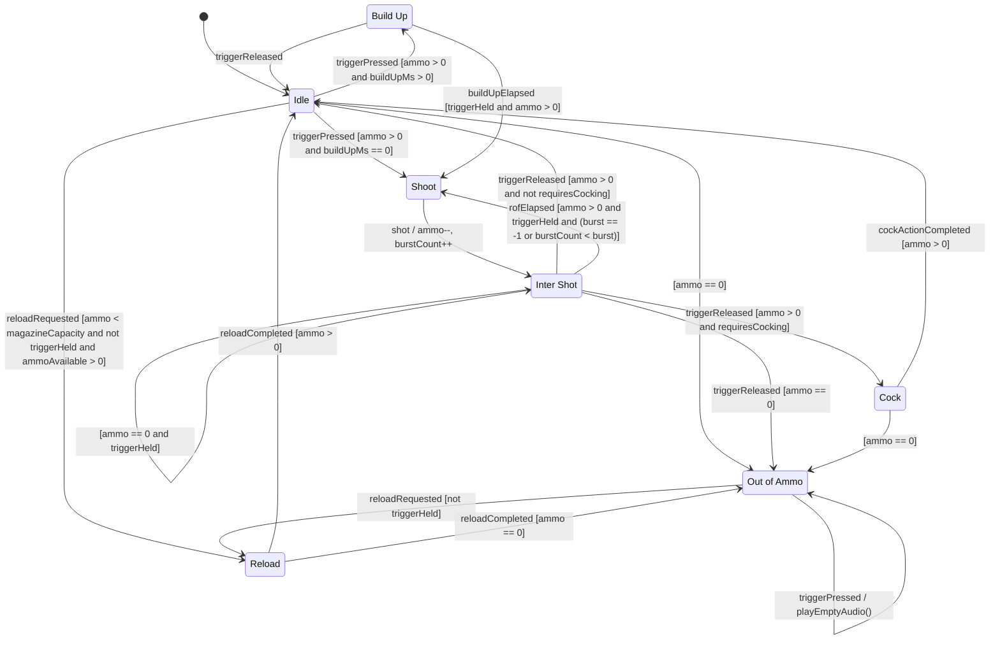

# CombatLR Weapon State Machine

This document describes the proposed data-driven weapon state machine. The diagram is Mermaid and renders in VS Code's Markdown preview and on GitHub.

## Weapon parameters

- `burst = 1`: one shot per trigger press.
- `burst = n`, where `n > 1`: fire up to `n` shots per trigger press.
- `burst = -1`: full-auto; continue firing while the trigger is held and ammunition remains.
- `ammo`: rounds remaining in the magazine.
- `magazineCapacity`: maximum magazine ammunition.
- `rofDelay`: minimum delay between shots.
- `buildUpMs`: optional timed build-up before the first shot.
- `requiresCocking`: whether manual cocking is required between shots.

The engine does not need separate SemiAuto, Burst and FullAuto modes. The `burst` value and guards determine the firing behaviour.

## Mermaid state diagram

## Transition rules and guards

### Firing

- Each entry into `Shoot` emits exactly one shot, decrements `ammo`, and increments `burstCount`.
- Every shot transitions to `InterShot`; the firing cadence is controlled by `rofDelay`.
- For finite bursts (`burst > 0`), another shot is permitted only while `burstCount < burst` and the trigger remains held.
- For full-auto (`burst == -1`), another shot is permitted whenever the trigger remains held and `ammo > 0`.
- Releasing the trigger cancels any remaining burst and prevents further shots.
- Once a finite burst is complete, remain in `InterShot` until the trigger is released.

### Empty magazine and empty-trigger audio

- When `ammo == 0`, remain in `InterShot` while the trigger is held, regardless of `burst`.
- On trigger release with `ammo == 0`, transition to `Empty`.
- Entering `Empty` does **not** play audio.
- A new trigger press while already in `Empty` plays the empty-weapon audio.
- Waiting for trigger release before entering `Empty` prevents the shot that consumed the last round from also triggering the empty-weapon sound.

### Reloading

- Reload is allowed from `Empty`.
- Reload is also allowed from `Idle` when `ammo < magazineCapacity`.
- Reload requests require the trigger to be released.
- On completion, return to `Idle` if `ammo > 0`; otherwise return to `Empty`.

### Cocking

- If `requiresCocking` is true, trigger release after a shot with ammunition remaining leads from `InterShot` to `Cock`.
- Cocking is not allowed when `ammo == 0`.
- On successful cocking, return to `Idle` if ammunition remains.
- The cocking input/mechanism should be modelled as an event; the state machine should not block while waiting.

## Implementation notes

- Treat `Shoot` as a one-shot entry action, not an action repeated on every state-machine update.
- Reset `burstCount` when a new trigger-initiated firing sequence begins.
- Give trigger release priority over `rofElapsed` if both are observed during the same update.
- The diagram documents the intended behaviour; the C++ state engine implements the actual guards and actions.
